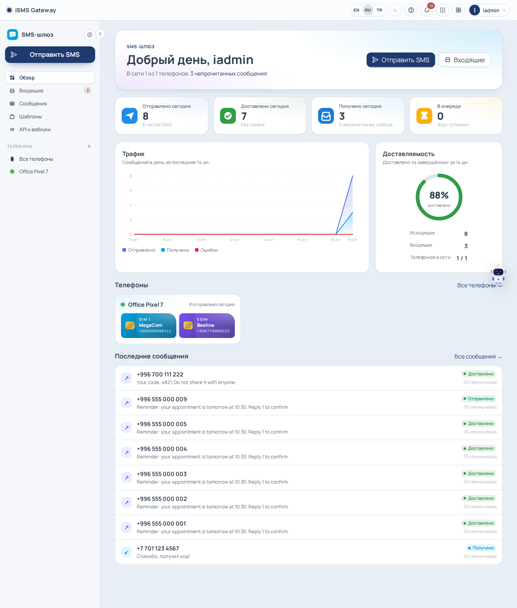
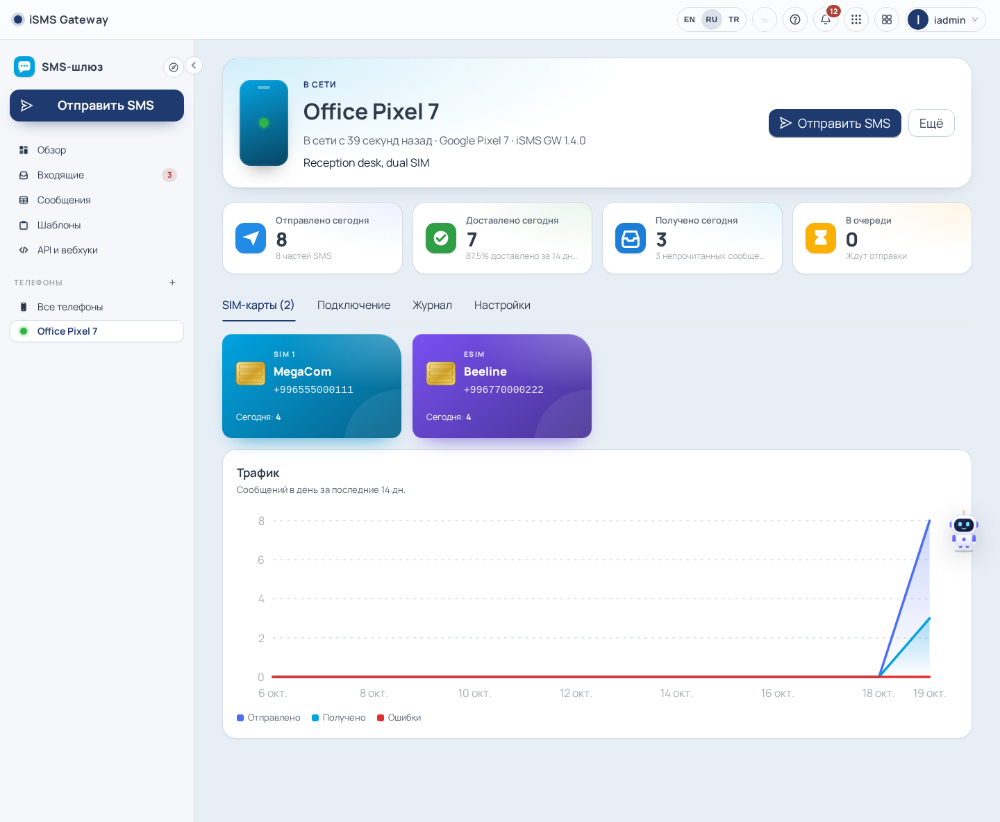
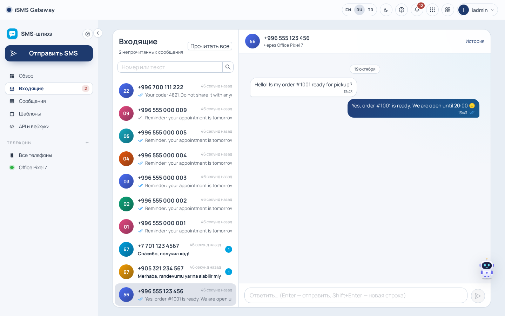
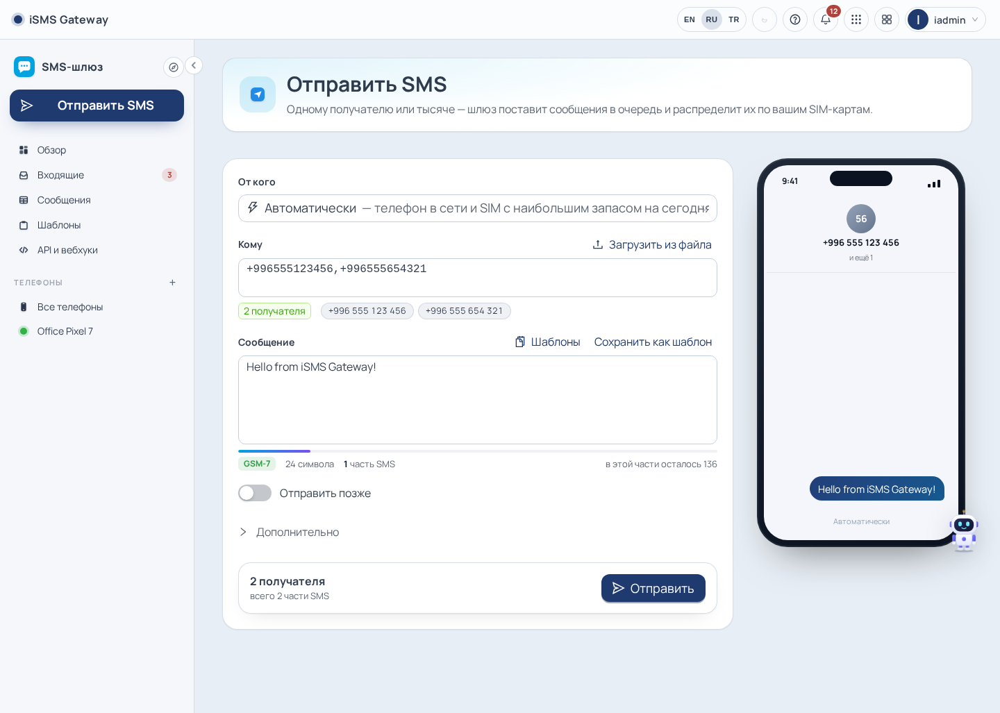
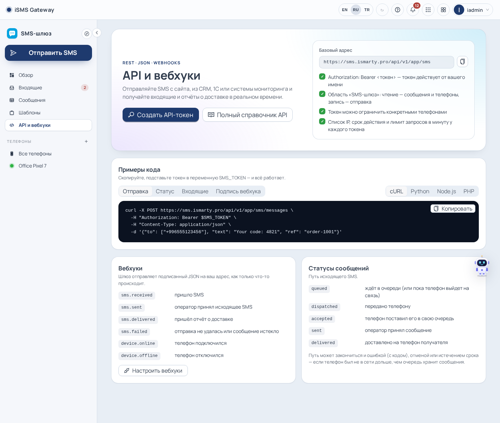

<div align="center">

# iSMS Gateway Server

**Turn Android phones into your own SMS gateway.**<br>
Many phones and SIM cards behind one web console, a two-way inbox, a REST API and webhooks — self-hosted, no aggregator in between.


[](LICENSE)

[Features](#features) · [How it works](#how-it-works) · [Quick start](#quick-start) · [Connect a phone](#connect-a-phone) · [API](#rest-api) · [Documentation](#documentation)

</div>

---

<p align="center">
  
</p>

The server works together with **[iSMS GW](https://github.com/iSmartyPRO/isms-gw-android)** — a free Android app that turns
a phone with a SIM card into a gateway. Each phone keeps a secure WebSocket connection to the server, so it works behind
NAT and on mobile data; the server routes your messages through the phones, tracks delivery and collects replies.

## Features

| | |
|---|---|
| 📱 **Phones and SIM cards** | Any number of Android phones, dual SIM and eSIM. Each SIM gets its own name, colour, daily limit and an on/off switch for sending. Live online status, connection journal, alerts when a phone goes silent. |
| 🧭 **Smart routing** | Leave “From” on auto: the gateway picks an online phone and the SIM with the most room left today and spreads mailings across SIMs. A per-phone sending rate protects SIM cards from carrier blocking. |
| ✅ **Delivery tracking** | `queued → dispatched → accepted → sent → delivered` with timestamps; clear error codes; retries when a phone does not confirm; offline phones get their messages when they reconnect. |
| 💬 **Two-way inbox** | Incoming SMS as conversations; replies leave through the same phone and SIM. Unread counters and notifications (push, e-mail, Telegram, WhatsApp). |
| ✉️ **Sending** | One recipient or a mailing of up to 1,000 numbers, CSV import, live number validation (E.164), GSM-7 / UCS-2 part counter, templates, scheduled sending. |
| 🔌 **REST API and webhooks** | `/api/v1/app/sms` with OpenAPI 3.1 and a developer portal. Tokens act on behalf of a person and can be limited to specific phones, IP addresses and an expiry date. Signed webhooks: `sms.received`, `sms.sent`, `sms.delivered`, `sms.failed`, `device.online`, `device.offline`. |
| 👥 **Team access** | Share a phone with a person, group or role: view, send or manage. Users, roles, SSO (AD/LDAP, Google, Telegram), sign-in codes, IP filtering, security log. |
| 🌍 **Languages** | Interface, landing page, help and a knowledge base with 14 guides in English, Russian and Turkish (Kyrgyz and Chinese fall back to English). Light and dark themes, mobile-friendly, installable as a PWA. |

<table>
  <tr>
    <td></td>
    <td></td>
  </tr>
  <tr>
    <td align="center"><b>Phone, SIM cards and limits</b></td>
    <td align="center"><b>Two-way inbox</b></td>
  </tr>
  <tr>
    <td></td>
    <td></td>
  </tr>
  <tr>
    <td align="center"><b>Send with preview and part counter</b></td>
    <td align="center"><b>API and webhooks</b></td>
  </tr>
</table>

## How it works

```
 Your systems ── HTTPS + Bearer token ──┐
 People ── browser (web console) ───────┤
                                        ▼
                      ┌──────────────────────────────────┐
                      │   iSMS Gateway Server (Docker)   │
                      │   nginx · Node.js · PostgreSQL   │──► webhooks to your URL
                      └──────────────────────────────────┘
                                        ▲
                     wss://<server>/ws/device (one token per phone)
                        │               │               │
                 Android + SIM    Android + SIM    Android + 2 SIM
                   (iSMS GW)        (iSMS GW)        (iSMS GW)
```

Phones connect to the server — not the other way round — so they need no public IP. Messages are queued in PostgreSQL;
a dispatcher hands them to connected phones at their pace and requeues what a phone did not confirm. Details:
[docs/sms.md](docs/sms.md).

## Quick start

**You need:** Docker Engine with Compose v2 and a PostgreSQL 14+ server the container can reach
([how to create the database](docs/postgres-setup.md)).

```bash
git clone https://github.com/iSmartyPRO/isms-gw-server.git
cd isms-gw-server

make env        # creates .env, generates JWT_SECRET and prints a SETUP_TOKEN
$EDITOR .env    # FRONTEND_URL, DOCKER_PORT, POSTGRES_*
make network    # creates the docker-lan network if missing
make up         # builds and starts the container
make health
```

Open `http://127.0.0.1:8092` (or your `DOCKER_PORT`): the **setup wizard** asks for the `SETUP_TOKEN`, the database
connection and the first administrator. When it is done the wizard locks itself for good.

For production put it behind HTTPS (see [reverse proxy](#reverse-proxy)) — phones should connect over `wss://`.

## Connect a phone

1. Install **[iSMS GW](https://github.com/iSmartyPRO/isms-gw-android/releases/latest)** on an Android 8+ phone with a SIM card and make it the default SMS app.
2. In the web console: **SMS gateway → Phones → Add a phone**. You get the server address `wss://<your-server>/ws/device` and a token (shown once).
3. In iSMS GW: **Settings → SMS server** — paste the address and the token, switch the connection on and start the gateway.
   The same can be done from a computer in the phone’s own web panel (its address is shown in the app).
4. The wizard notices the phone at once and shows its SIM cards. Exclude iSMS GW from battery optimisation and keep the phone charging.

## REST API

```bash
curl -X POST https://sms.example.com/api/v1/app/sms/messages \
  -H "Authorization: Bearer $SMS_TOKEN" \
  -H "Content-Type: application/json" \
  -d '{"to": ["+996555123456"], "text": "Your code: 4821", "ref": "order-1001"}'
```

| Method | Endpoint | |
|---|---|---|
| `POST` | `/messages` | Send to one or many numbers (`to`, `text`, optional `deviceId`, `simId`, `sendAt`, `ref`) |
| `GET` | `/messages/{id}` | Status of a message (id or uuid) |
| `GET` | `/messages?direction=in&sinceId=…` | Poll incoming (also filters by status, phone, text, dates) |
| `POST` | `/messages/{id}/cancel` · `/messages/{id}/retry` | Cancel a queued message · send a failed one again |
| `GET` | `/threads` · `/threads/{deviceId}/{phone}` | Conversations |
| `GET` | `/devices` | Phones with SIM cards, online state and today’s counters |
| `GET` | `/overview` | Today’s figures and a daily series |

Base URL `https://<server>/api/v1/app/sms`. Create tokens in **Account → API tokens**, webhooks in
**Administration → API**. The full reference with examples in cURL, Python, Node.js and PHP is built in at `/developers`.

## Configuration

Bootstrap configuration lives in `.env` (template: [`.env.example`](.env.example)); everything else is edited in the console.

| Variable | Default | Purpose |
|----------|---------|---------|
| `DOCKER_NAME` / `DOCKER_PORT` | `isms-gateway` / `8092` | Container name and published port (`10.0.0.5:8092` binds a single address) |
| `FRONTEND_URL` | `http://localhost:8092` | Public origin; `https://` turns on `Secure` cookies |
| `JWT_SECRET` · `SETUP_TOKEN` | generated by `make env` | Session key · setup wizard secret |
| `POSTGRES_*` / `DATABASE_URL` | — | Database connection |
| `TRUST_PROXY_HOPS` | `1` | Proxies in front of Express (the bundled nginx counts as one) |

SMS settings (**Settings → Modules → SMS gateway**): default country for local numbers, who may add phones, messages per
minute, queue lifetime, confirmation timeout and attempts, recipients per request, text length, retention, offline alert.

### Reverse proxy

Behind another proxy set `TRUST_PROXY_HOPS=2`, forward the client address and **pass WebSocket upgrades** (for `/ws/device`):

```nginx
location / {
    proxy_pass         http://127.0.0.1:8092;
    proxy_http_version 1.1;
    proxy_set_header   Upgrade           $http_upgrade;
    proxy_set_header   Connection        $http_connection;
    proxy_set_header   Host              $host;
    proxy_set_header   X-Real-IP         $remote_addr;
    proxy_set_header   X-Forwarded-For   $proxy_add_x_forwarded_for;
    proxy_set_header   X-Forwarded-Proto $scheme;
    proxy_read_timeout 300s;
}
```

> [!NOTE]
> The phone hub keeps connections in memory — run a single backend instance.

## Security

- One token per phone (`smsgw_…`), shown once and stored as SHA-256; replacing it disconnects the phone at once. Wrong tokens are rate-limited per address.
- Access levels per phone (view / send / manage); API tokens can only narrow their owner’s rights and can be limited to phones and IP addresses.
- Parameterized SQL, CSRF protection, `SameSite` cookies, sign-in lockouts, IP allow/deny lists, security log.
- The app runs as an unprivileged user in a container with digest-pinned base images.

Threat model and go-live checklist: [docs/security.md](docs/security.md). Report vulnerabilities privately — see [SECURITY.md](SECURITY.md).

## Development

```bash
make dev                              # Vite :3020 + API :3021 with hot reload
cd src/backend  && npm test           # unit tests (node:test)
cd src/frontend && npm run i18n:check # translations
cd src/frontend && npm run build
```

End-to-end check with a simulated phone that speaks the iSMS GW protocol: [`scripts/sms-e2e.mjs`](scripts/sms-e2e.mjs).

## Documentation

| Guide | Contents |
|-------|----------|
| [SMS gateway](docs/sms.md) | Module design: protocol, queue and statuses, routing, access, webhooks, settings, tests |
| [Plan](docs/sms-gateway-plan.md) | Product plan and protocol analysis (Russian) |
| [Public API](docs/public-api.md) | Tokens, scopes, limits, webhooks and their signature |
| [Getting started](docs/getting-started.md) · [Configuration](docs/configuration.md) · [Operations](docs/operations.md) | Install, configure, back up, upgrade |
| [Architecture](docs/architecture.md) · [Modules](docs/modules.md) · [Extending](docs/extending.md) | How the platform is built and extended |
| [Security](docs/security.md) · [Access control](docs/access-control.md) · [i18n](docs/i18n.md) | Security model, roles and permissions, translations |

Built on the iApp-Skeleton platform (users, roles, settings, API tokens, webhooks, notifications, help, knowledge base).

## License

[MIT](LICENSE) © iSmartyPro. The Android app [iSMS GW](https://github.com/iSmartyPRO/isms-gw-android) is licensed separately (Apache-2.0).
